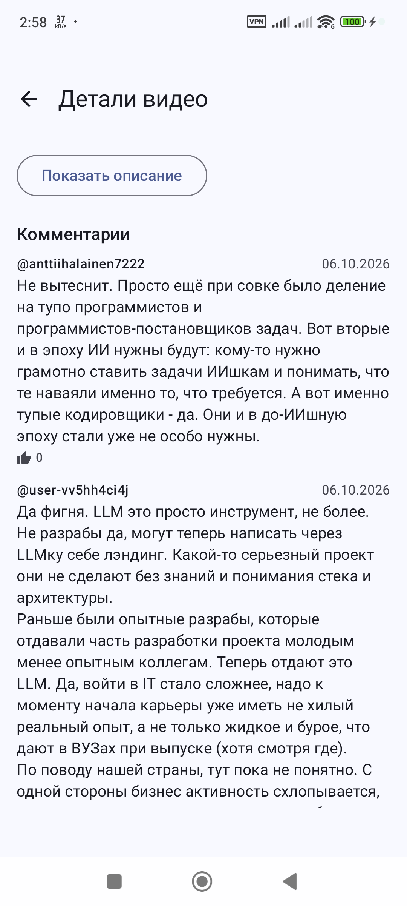

# LocalTube

**Оффлайн-YouTube для Android.** Вставьте ссылку на видео — скачайте его с русской озвучкой и смотрите без интернета: встроенный плеер, библиотека, комментарии.

## Возможности

- **Добавление по ссылке** — YouTube, метаданные (название, канал, длительность, обложка) подтягиваются автоматически
- **Скачивание в фоне** — движок yt-dlp + ffmpeg работает прямо на устройстве, без серверов; прогресс, скорость, отмена
- **Аудиодорожки** — выбор: оригинал / русская озвучка / обе дорожки сразу (mkv с двумя треками, подписанными языком)
- **Библиотека** — все скачанные видео с обложками, длительностью и датой; детали и удаление
- **Оффлайн-плеер** (Media3/ExoPlayer) — запоминание позиции, полноэкранный режим, переключение аудиодорожек, пауза при уходе в фон
- **Комментарии** — как на YouTube: с ответами, по тапу «N ответов»
- **Всё локально** — данные и видео хранятся только на вашем устройстве

## Скриншоты

| Экран деталей (онлайн) |
|---|
|  |

## Установка

### Готовый APK

Скачайте `LocalTube1.0.apk` со страницы [Releases](https://github.com/Rafael/LocalTube/releases) и установите
(при первом запуске Android попросит разрешить «Установку из неизвестных источников»).

### Сборка из исходников

Требования: **JDK 17**, **Android SDK** (platform 34, build-tools 34.0.0), Gradle не нужен — используется wrapper.

```bat
:: Windows
gradlew.bat assembleDebug
```

```sh
# Linux / macOS
./gradlew assembleDebug
```

Готовый APK: `app/build/outputs/apk/debug/app-debug.apk`.

## Как это работает

APK содержит бандл **yt-dlp 2026.08.19** и **ffmpeg** (через библиотеку [youtubedl-android](https://github.com/yausername/youtubedl-android)).
Скачивание, слияние видео+аудио и тегирование дорожек выполняются локально на устройстве — приложение не использует никаких сторонних серверов.

## Структура проекта

```
app/src/main/java/com/localtube/
├── data/        # Room (Video/DownloadTask/Comment), репозитории, DI-контейнер
│   └── downloader/  # yt-dlp: инициализация, форматы, скачивание, прогресс
├── ui/          # Compose: library, downloads, add, settings, details, player
└── LocalTubeApp.kt
```

## Лицензия

Код приложения распространяется под **MIT** — см. [LICENSE](LICENSE).
Сторонние компоненты (yt-dlp, ffmpeg, youtubedl-android) и их лицензии — в [THIRD_PARTY_LICENSES.md](THIRD_PARTY_LICENSES.md).
